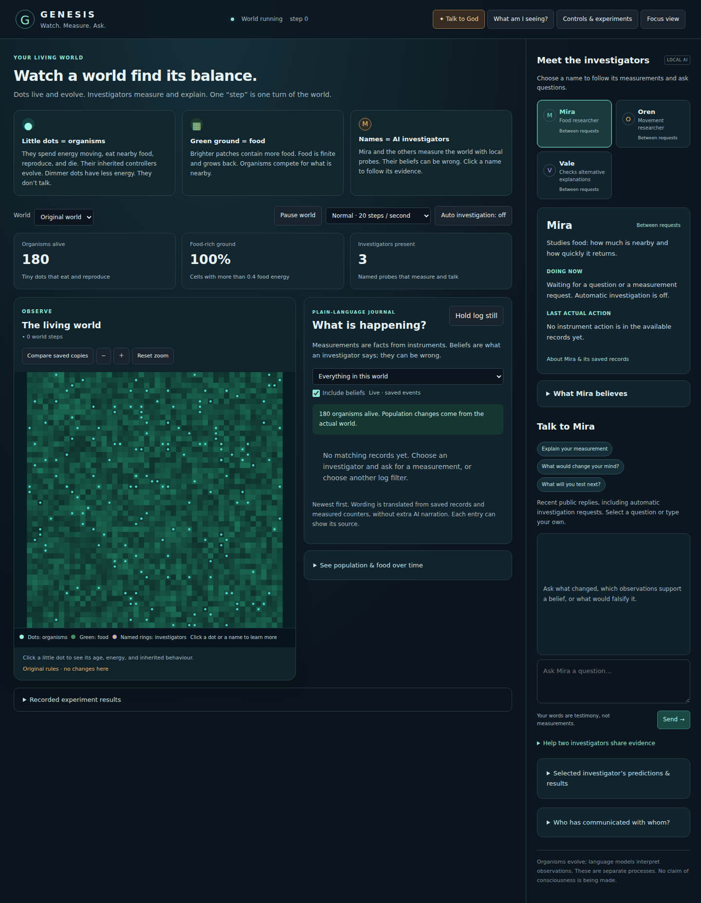

# Genesis Observatory

A persistent artificial ecology and local language-agent investigation environment. It helps explore bounded experiments, evidence, interventions, and replay without treating generated testimony as proof.

**Maturity:** Experimental research application. Ecology, scoped instruments, persistence, checkpoint branches, and replay have executable coverage. Language-agent outcomes remain experiments, not intelligence claims.

*Initial synthetic view; model inference and background processing were not exercised for this image.*

## How it works

Vanilla browser UI → FastAPI → SQLite WAL store and a seeded 48×48 world. Organisms inherit compact neural controllers. Separate investigator, contact and steward brokers restrict model tools and record observations. Local Ollama serves language models.

## Getting started

Read [installation, configuration and shutdown](docs/OPERATIONS.md) and [model/data retrieval](docs/MODELS.md). Review [dependency evidence](docs/DEPENDENCIES.md) before choosing an environment. The safe review launcher uses loopback and does not install services or load models.

## Security and data

Read [security and safe updates](SECURITY.md) and [ownership/license status](docs/LICENSE-STATUS.md). Runtime originals are preserved separately. This is a sanitized source snapshot with new history: no account state, business records, model weights, unknown media assets or original logs/history are distributed. Third-party notices included in this copy remain applicable.

## Verification

See [verification evidence and limitations](docs/VERIFICATION.md). Tests distinguish synthetic/mocked workflows from live integrations. Original demo screenshots and document recordings are excluded; use the synthetic workflow in the operations guide for your own reviewed demonstration.

## Roadmap

Improve held-out protocols and model error disclosure; compare baselines with fixed experiment budgets; add accessible replay inspection. Avoid claims of cooperation or mutation advantage unless the measurements support them.

For route/source details see [architecture](docs/ARCHITECTURE.md).
